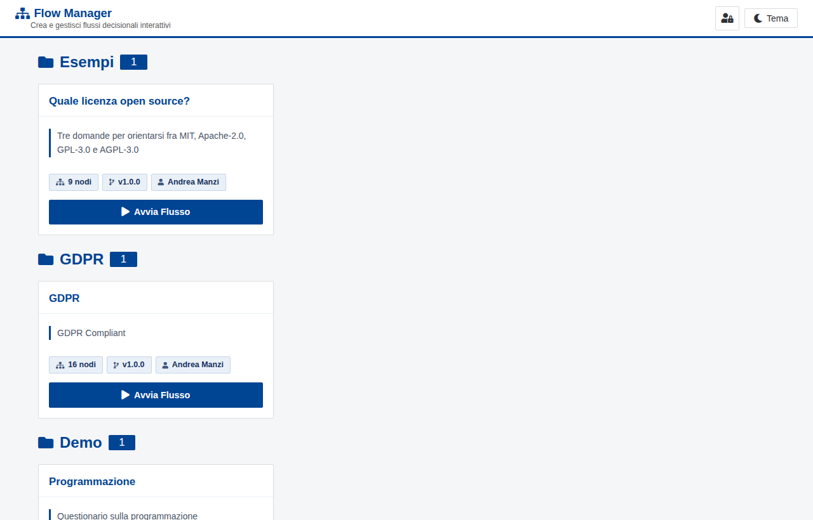
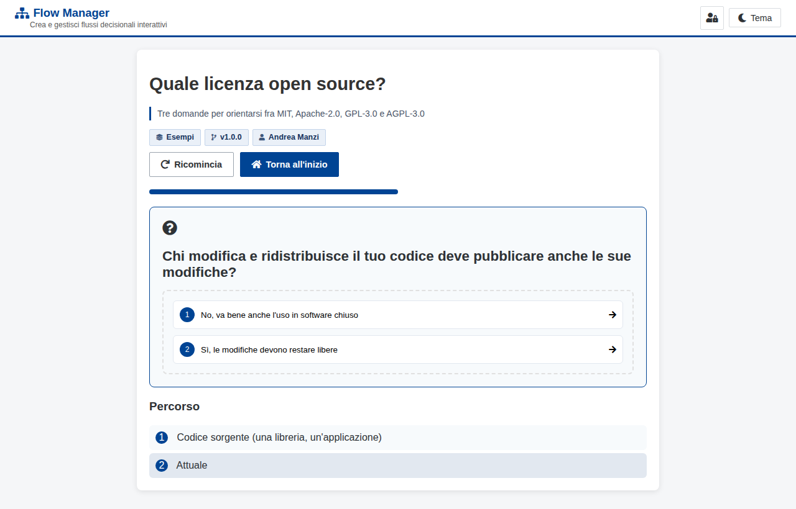
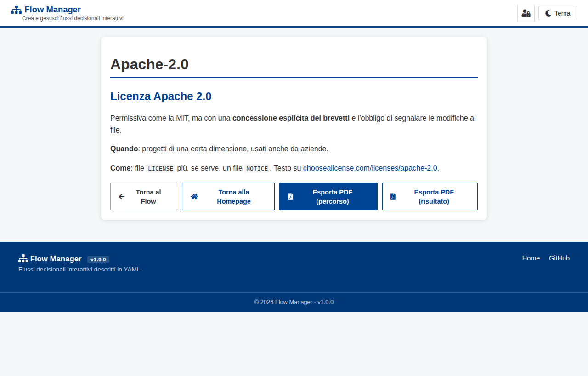
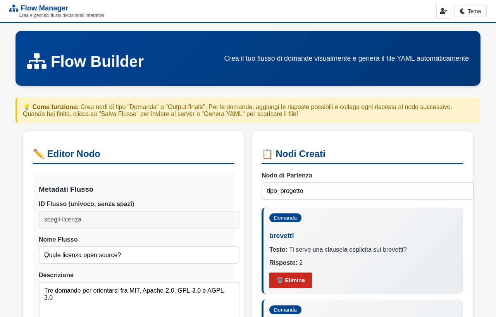

# Flow Manager

Flussi decisionali interattivi descritti in YAML: una domanda, le risposte possibili, e ogni
risposta porta alla domanda successiva o a un esito scritto in Markdown. Chi lo usa risponde
nel browser, vede il percorso fatto e alla fine può scaricare l'esito in PDF.

Un'app Flask piccola, senza database: un flusso è un file `.yaml` in `flows/`, e si aggiunge o si
corregge senza riavviare niente.

**▶ Demo: [manzolo.github.io/flow-manager](https://manzolo.github.io/flow-manager/)** (versione
statica di sola lettura, con i flussi di [`examples/`](examples/))

| Home | Una domanda |
|---|---|
|  |  |
| **L'esito, esportabile in PDF** | **Il builder (admin)** |
|  |  |

C'è anche il tema scuro ([screenshot](docs/screenshots/05-tema-scuro.png)).

## Avvio rapido (Docker)

```bash
git clone https://github.com/manzolo/flow-manager.git
cd flow-manager
make demo          # copia gli esempi in flows/
make up            # crea .env da .env.example, build e avvio
```

Poi apri <http://localhost:8000>. Per usare il builder imposta `ADMIN_PASSWORD` in `.env`
(almeno 8 caratteri) e rilancia `make up`: finché resta vuota il login è disabilitato.

Senza Docker: `make run-local` (crea un venv e parte su <http://localhost:5000>).

| Comando | Cosa fa |
|---|---|
| `make demo` | copia `examples/*.yaml` in `flows/` senza sovrascrivere |
| `make up` / `make down` | avvia / ferma con docker compose |
| `make logs` · `make health` | log del container · prova `/health` |
| `make run-local` | avvio senza Docker, in un venv |
| `make test` | test con pytest |

## Come si scrive un flusso

### Dove si mette

Un flusso è **un file `.yaml` nella cartella `flows/`**. Il nome del file (senza `.yaml`) è l'id
del flusso e finisce nell'indirizzo: `flows/scegli-licenza.yaml` si apre su
`/flow/scegli-licenza`. L'app rilegge la cartella a ogni richiesta, quindi un file nuovo o
modificato compare **senza riavviare**; con Docker `flows/` è un volume montato dall'host.

In alternativa si crea dal **builder** (`/builder`, serve il login admin), che salva lo stesso
file YAML in `flows/`; dalla pagina del flusso, *Esporta* lo riscarica.

### Il formato

Un esempio minimo, con tutto quello che serve:

```yaml
start_node: tipo_progetto          # il primo nodo che si vede

metadata:
  name: Quale licenza open source? # titolo nella home e nella pagina
  description: Tre domande per orientarsi fra MIT, Apache-2.0, GPL-3.0 e AGPL-3.0
  category: Esempi                 # la home raggruppa i flussi per categoria
  version: 1.0.0                   # semver
  author: Andrea Manzi
  order: 1                         # facoltativo: ordine nella home (crescente)

nodes:
  tipo_progetto:                   # id del nodo: lettere, numeri, _ e -
    type: question
    text: "Che cosa stai pubblicando?"
    answers:
      - label: "Codice sorgente"
        next: brevetti             # id del nodo successivo
      - label: "Documentazione, testi o immagini"
        next: out_cc_by

  brevetti:
    type: question
    text: "Ti serve una clausola esplicita sui brevetti?"
    answers:
      - label: "No"
        next: out_mit
      - label: "Sì"
        next: out_apache

  out_mit:
    type: output                   # un esito: qui il percorso finisce
    title: "MIT"
    content: |
      ## Licenza MIT
      Il testo è **Markdown**: titoli, elenchi, tabelle, link, blocchi di codice.

  out_apache:
    type: output
    title: "Apache-2.0"
    content: |
      Permissiva come la MIT, con una concessione esplicita dei brevetti.

  out_cc_by:
    type: output
    title: "CC BY 4.0"
    content: |
      Per i contenuti che non sono codice.
```

Le regole sono poche:

- due tipi di nodo: `question` (con `text` e `answers`, ognuna con `label` e `next`) e `output`
  (con `title` e `content` in Markdown);
- ogni `next` deve puntare a un nodo che esiste, e ogni nodo deve essere raggiungibile da
  `start_node`;
- un esito può essere raggiunto da più risposte, e una domanda può tornare indietro a una
  precedente.

Il flusso completo è in [`examples/scegli-licenza.yaml`](examples/scegli-licenza.yaml); gli altri due
esempi mostrano un albero più grande (`flow-demo.yaml`, 16 nodi) e immagini e codice negli esiti
(`flow-programming.yaml`).

### Controllarlo prima di pubblicarlo

Il validatore segnala nodi mancanti, riferimenti rotti e nodi irraggiungibili. Dall'app è
`POST /api/flows/validate`, oppure da riga di comando:

```bash
python3 -c "import yaml,sys; from utils.flow_validator import FlowValidator; \
print(FlowValidator().validate(yaml.safe_load(open(sys.argv[1]))))" flows/mio-flusso.yaml
# (True, [])  oppure  (False, ['...'])
```

`make test` controlla anche che tutti i file di `examples/` siano validi.

## La demo su GitHub Pages

GitHub Pages serve solo file statici, quindi la demo è un **export**:
[`export_static.py`](export_static.py) renderizza con Flask la home, una pagina per flusso e una per
ogni esito, e il visualizzatore legge i nodi dalla pagina invece che dalle API. Si percorrono i
flussi e si scarica il PDF come nell'app; builder e login non ci sono.

```bash
python3 export_static.py --flows examples --out _site      # --base /flow-manager per Pages
python3 -m http.server -d _site 8080                       # anteprima su http://localhost:8080
```

Il workflow [`.github/workflows/pages.yml`](.github/workflows/pages.yml) a ogni push su `main` esegue i
test, fa l'export di `examples/` e lo pubblica. In un fork basta abilitare **Settings → Pages →
Source: GitHub Actions**; per pubblicare i propri flussi si cambia `--flows examples` nel workflow.

## Configurazione

Tutto da variabili d'ambiente, con docker compose dal file `.env` (modello in
[`.env.example`](.env.example)).

| Variabile | Default | Cosa fa |
|---|---|---|
| `ADMIN_MODE` | `True` | builder e API di scrittura chiedono il login. Con `False` può modificare chiunque: solo in locale |
| `ADMIN_PASSWORD` | *(vuota)* | password admin; vuota, corta o d'esempio = login disabilitato |
| `SECRET_KEY` | casuale a ogni avvio | firma delle sessioni; impostala se vuoi che il login sopravviva a un riavvio |
| `SITE_TITLE`, `SITE_SUBTITLE`, `SITE_TAGLINE` | Flow Manager… | testi di header e footer |
| `ORG_NAME`, `ORG_URL` | — | link alla tua organizzazione nel footer |
| `FLOWS_DIRECTORY` | `flows` | cartella dei flussi |
| `SESSION_COOKIE_SECURE` | `False` | `True` dietro HTTPS |
| `ALLOWED_ORIGINS` | `*` | CORS delle API |
| `RATELIMIT_STORAGE_URI` | `memory://` | es. `redis://…` con più istanze |
| `PORT` | `8000` | porta pubblicata da docker compose |

## API

| Metodo e percorso | Cosa fa | Login |
|---|---|---|
| `GET /api/flows` | elenco dei flussi | |
| `GET /api/flows/<id>` | un flusso intero | |
| `GET /api/flows/<id>/node/<node>` | un nodo | |
| `GET /api/flows/export/<id>` | scarica lo YAML | |
| `POST /api/flows/validate` | valida un flusso | |
| `POST /api/flows` · `PUT /api/flows/<id>` · `DELETE /api/flows/<id>` | crea, aggiorna, cancella | sì |
| `GET /health` | stato dell'app | |

## Struttura

```
app.py                 route Flask e FlowManager (lettura e scrittura dei YAML)
config.py              configurazione da variabili d'ambiente
utils/flow_validator.py  validazione dei flussi
templates/, static/    pagine Jinja, CSS e JS; le librerie front-end sono in static/vendor (niente CDN)
export_static.py       export statico per GitHub Pages
examples/              flussi di esempio
flows/                 i tuoi flussi (fuori da git)
```

## Licenza

[MIT](LICENSE). Le librerie in `static/vendor/` hanno le loro licenze, tutte permissive: elenco in
[`static/vendor/README.md`](static/vendor/README.md).
